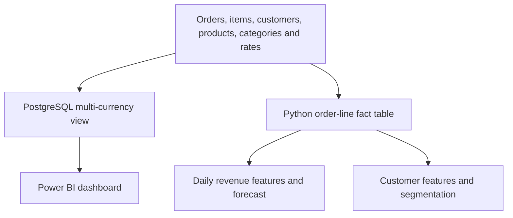

# Multi-Currency Retail Analytics

A small retail workshop dataset connects three questions: how much customers spent, how well daily revenue can be forecast, and which customers buy in similar ways. PostgreSQL and Power BI support the sales dashboard. A separate Python pipeline uses the same six CSVs for forecasting and segmentation.

## Dashboard demo


The sample contains **200 orders from 20 customers**, worth **€61,351.01** in revenue. Average order value is **€306.76**. The dashboard lets a reader change the reporting currency and filter by date. [Power BI file](powerbi/Retail_Sales_Multi_Currency_Dashboard.pbix) · [Business summary](outputs/demo/reports/business_summary.json)

## Forecast and segmentation

| Question | Result on the sample |
|---|---|
| How well does the model forecast from information available at the start of a month-long window? | Across three consecutive 30-day windows, random forest MAE was **€115.44 per day**. Carrying the preceding seven-day mean through each window gave **€165.67**. |
| How informative is the historical fit? | With the target day's order activity already observed, MAE was €17.38. This is a retrospective estimate with access to information unavailable at forecast time. |
| Are the customer groups distinct? | K-means produced four groups from 20 customers. A silhouette score of **0.207** suggests weak separation. |

These are results on one small course dataset. [Forecast metrics](outputs/demo/reports/sales_forecast_metrics.json) · [Segment summary](outputs/demo/reports/customer_segment_summary.csv) · [Segment visualization](docs/figures/customer_segments_recency_monetary.png)

## Workflow



## Run the analysis

With Python 3.10+ in a virtual environment, run from the repository root:

```sh
python -m pip install -e .
python -m retail_analytics_ml.cli run-all --data-dir data/raw --output-dir outputs/local
```

This writes processed tables, charts, metrics and models without a database connection. To rebuild the SQL side, run the [numbered SQL scripts](sql) in order using PostgreSQL and psql from the repository root. [Data dictionary](docs/DATA_DICTIONARY.md) · [ML design](docs/ML_DESIGN.md)
