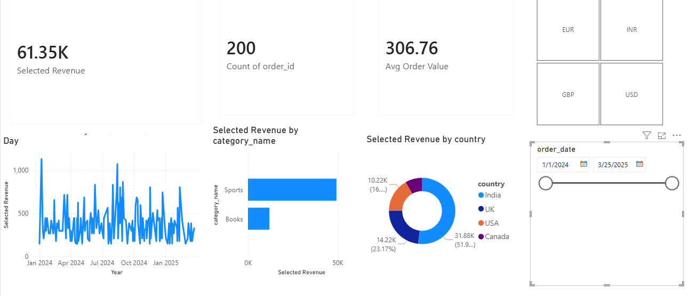
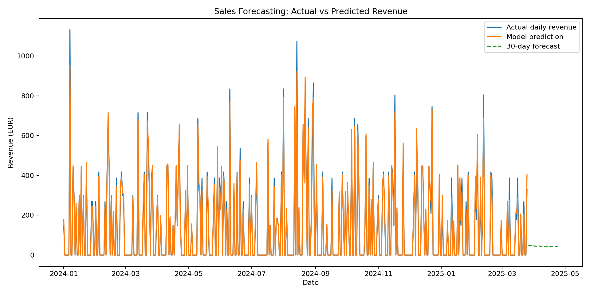
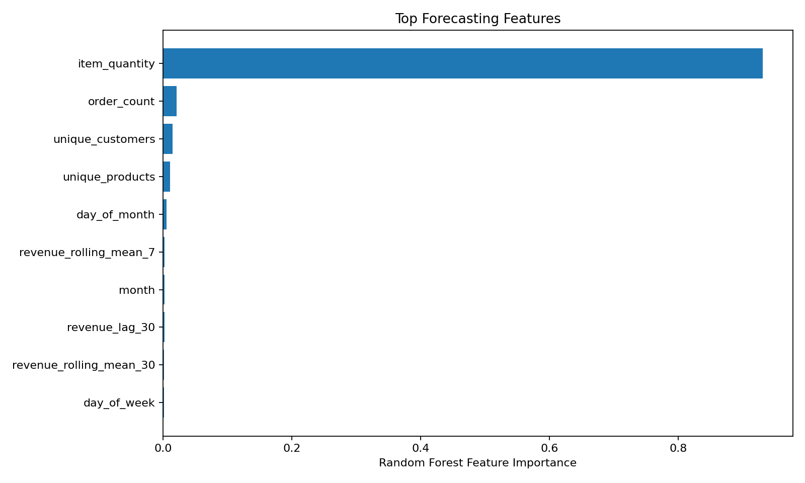
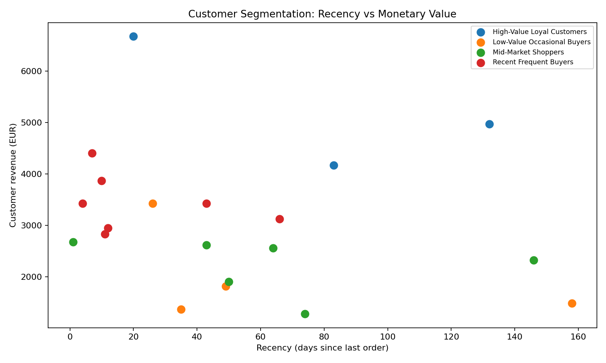
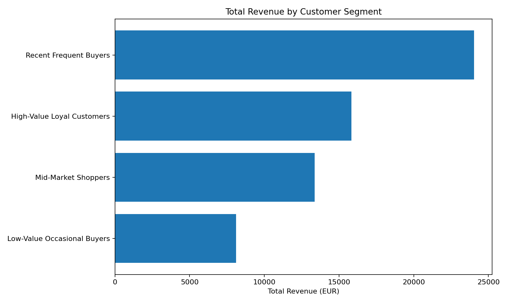
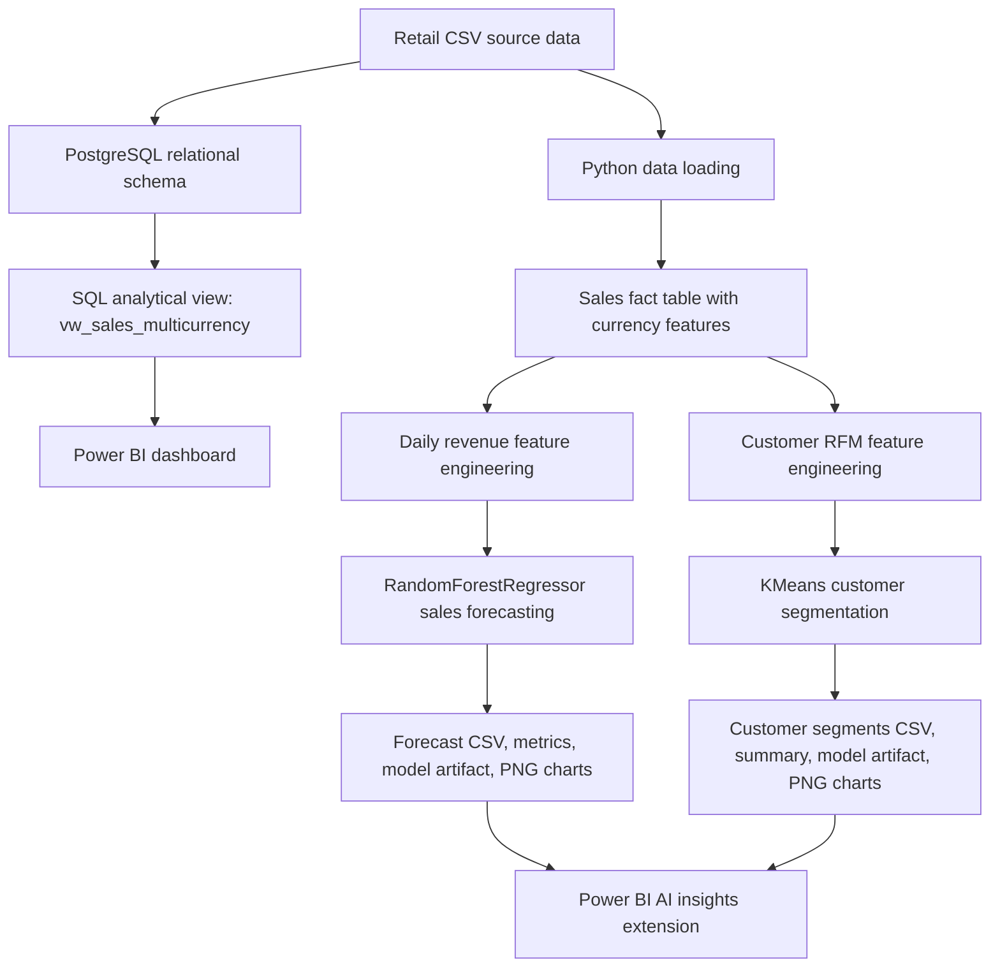

# Retail Multi-Currency Analytics & ML Forecasting Pipeline

An end-to-end retail analytics project that combines **PostgreSQL**, **SQL transformations**, **Power BI**, and **machine learning** to analyze sales performance, convert revenue across currencies, forecast future revenue, and segment customers by purchasing behavior.

This project was rebuilt from a course-based Power BI/SQL workshop into a professional GitHub portfolio project. It keeps the original business-intelligence workflow and extends it with two ML components:

1. **Sales Forecasting** with `RandomForestRegressor`
2. **Customer Segmentation** with `KMeans` clustering

The project is best positioned for:

- **Business Intelligence**: KPI reporting, Power BI dashboarding, interactive currency/date filtering, and business-facing visual analytics.
- **Analytics Engineering**: relational schema design, SQL joins/views, PostgreSQL data modeling, reusable analytical datasets, and BI-ready semantic outputs.
- **Machine Learning Engineering**: feature engineering, model training, evaluation metrics, serialized model artifacts, and ML outputs that can be consumed by Power BI.

---

## Dashboard Preview

The Power BI dashboard provides revenue KPIs, order count, average order value, revenue trend, category breakdown, country distribution, currency slicer, and date filtering.



---

## ML Output Previews

### Sales Forecasting

The forecasting module trains a Random Forest model on daily revenue features and generates historical predictions plus a 30-day forward forecast.



### Forecast Feature Importance

The model also exports feature importance so the forecast is easier to interpret from a business perspective.



### Customer Segmentation

The segmentation module creates RFM-style customer features and groups customers into interpretable business segments.



### Revenue by Segment

The customer segment summary can be used in Power BI to analyze which customer groups generate the most revenue.



---

## Project Workflow



---

## Repository Structure

```text
retail_multicurrency_analytics_ml/
├── data/
│   └── raw/                         # Retail and exchange-rate CSV source data
├── docs/
│   ├── screenshots/                 # Power BI dashboard screenshot
│   ├── figures/                     # Generated ML charts
│   ├── DATA_DICTIONARY.md
│   └── ML_DESIGN.md
├── notebooks/
│   └── exchange_rate_api_ingestion.ipynb
├── outputs/
│   └── demo/                        # Reproducible generated demo outputs
├── powerbi/
│   └── Retail_Sales_Multi_Currency_Dashboard.pbix
├── sql/
│   ├── 01_create_tables.sql
│   ├── 02_load_csv_with_psql.sql
│   ├── 03_create_multicurrency_view.sql
│   └── 04_analytical_queries.sql
├── src/
│   └── retail_analytics_ml/
│       ├── cli.py
│       ├── data_loader.py
│       ├── feature_engineering.py
│       ├── forecasting.py
│       ├── segmentation.py
│       └── reporting.py
├── tests/
├── requirements.txt
├── requirements-dev.txt
├── pyproject.toml
└── README.md
```

---

## Data Sources

The project uses a small retail transaction dataset with six main CSV tables:

| File | Purpose |
|---|---|
| `categories.csv` | Product category dimension |
| `customers.csv` | Customer dimension with country, city, and signup date |
| `products.csv` | Product dimension with price and cost |
| `orders.csv` | Order header table with date, customer, and status |
| `order_items.csv` | Order-line table with product, quantity, and unit price |
| `exchange_rates.csv` | EUR-based exchange-rate data for multi-currency reporting |

The source price is treated as EUR. Exchange rates are used to calculate revenue in additional currencies such as USD, GBP, and INR.

---

## Business Intelligence Layer

The Power BI dashboard is built around a multi-currency sales view. It includes:

- Total selected revenue
- Distinct order count
- Average order value
- Revenue trend by date
- Revenue by category
- Revenue by country
- Currency slicer
- Date range slicer

The dashboard demonstrates how SQL views and DAX measures can work together to support interactive business reporting.

Example DAX concept used in the Power BI report:

```DAX
Selected Revenue =
SWITCH(
    SELECTEDVALUE('Currency Picker'[Currency], "EUR"),
    "EUR", SUM(vw_sales_multicurrency[revenue_eur]),
    "USD", SUM(vw_sales_multicurrency[revenue_usd]),
    "GBP", SUM(vw_sales_multicurrency[revenue_gbp]),
    "INR", SUM(vw_sales_multicurrency[revenue_inr])
)
```

---

## SQL / Analytics Engineering Layer

The SQL layer creates a normalized relational model and a BI-ready analytical view.

Core tables:

```text
customers → orders → order_items → products → categories
exchange_rates → vw_sales_multicurrency
```

The analytical view `vw_sales_multicurrency` joins order, customer, product, category, and exchange-rate data into one Power BI-friendly view.

Key SQL outputs:

- Total revenue
- Average order value
- Revenue by category
- Revenue by country
- Daily sales trend
- Customer-level RFM base for ML segmentation

---

## Machine Learning Layer

### 1. Sales Forecasting

**Goal:** predict daily revenue and generate a 30-day forward forecast.

**Model:** `RandomForestRegressor`

**Feature groups:**

- Calendar features: day of week, month, quarter, weekend flag
- Business activity features: order count, item quantity, unique customers, unique products
- Time-series features: revenue lags and rolling averages

Generated outputs:

```text
outputs/demo/reports/sales_forecast.csv
outputs/demo/reports/sales_forecast_metrics.json
outputs/demo/reports/sales_forecast_feature_importance.csv
outputs/demo/models/sales_forecast_random_forest.joblib
```

Demo model metrics:

| Metric | Value |
|---|---:|
| MAE | 17.38 |
| RMSE | 35.81 |
| MAPE on non-zero revenue days | 19.40% |
| R² | 0.953 |
| Baseline MAE, previous 7-day mean | 145.61 |

> Note: this is a driver-assisted forecasting baseline for a small course dataset. It is useful for demonstrating ML workflow design, not for claiming production forecasting accuracy.

### 2. Customer Segmentation

**Goal:** group customers into business-friendly segments based on purchasing behavior.

**Model:** `KMeans`

**Feature groups:**

- Recency
- Frequency
- Monetary value
- Average order value
- Total quantity
- Unique products/categories
- Profit margin

Generated outputs:

```text
outputs/demo/reports/customer_segments.csv
outputs/demo/reports/customer_segment_summary.csv
outputs/demo/reports/customer_segmentation_metrics.json
outputs/demo/models/customer_segmentation_kmeans.joblib
outputs/demo/models/customer_segmentation_scaler.joblib
```

Demo segment summary:

| Segment | Customers | Total Revenue EUR | Avg Frequency | Avg Recency Days |
|---|---:|---:|---:|---:|
| Recent Frequent Buyers | 7 | 24,043.53 | 11.29 | 21.86 |
| High-Value Loyal Customers | 3 | 15,822.93 | 15.67 | 78.33 |
| Mid-Market Shoppers | 6 | 13,376.23 | 7.00 | 63.00 |
| Low-Value Occasional Buyers | 4 | 8,108.32 | 8.00 | 67.00 |

---

## Quick Start

### 1. Create and activate a virtual environment

```bash
python -m venv .venv
```

Windows PowerShell:

```powershell
.\.venv\Scripts\Activate.ps1
```

macOS/Linux:

```bash
source .venv/bin/activate
```

### 2. Install dependencies

```bash
pip install -r requirements-dev.txt
pip install -e .
```

### 3. Run the full Python ML pipeline

```bash
python -m retail_analytics_ml.cli run-all \
  --data-dir data/raw \
  --output-dir outputs/demo
```

Or use the installed CLI:

```bash
retail-analytics-ml run-all \
  --data-dir data/raw \
  --output-dir outputs/demo
```

### 4. Run checks

```bash
pytest
ruff check src tests
```

---

## PostgreSQL Setup

Create the schema:

```bash
psql -U postgres -d retail_workshop -f sql/01_create_tables.sql
```

Load CSV files:

```bash
psql -U postgres -d retail_workshop -f sql/02_load_csv_with_psql.sql
```

Create the Power BI analytical view:

```bash
psql -U postgres -d retail_workshop -f sql/03_create_multicurrency_view.sql
```

Run analytical validation queries:

```bash
psql -U postgres -d retail_workshop -f sql/04_analytical_queries.sql
```

---

## Power BI Usage

Open:

```text
powerbi/Retail_Sales_Multi_Currency_Dashboard.pbix
```

The report can be connected to PostgreSQL using:

```text
Server: localhost
Database: retail_workshop
Mode: Import
```

To extend the dashboard with ML pages, import these generated files:

```text
outputs/demo/reports/sales_forecast.csv
outputs/demo/reports/customer_segments.csv
outputs/demo/reports/customer_segment_summary.csv
```

Suggested Power BI pages:

1. Executive Sales Dashboard
2. Sales Forecasting
3. Customer Segmentation

---

## What This Project Demonstrates

### Business Intelligence

- Interactive Power BI dashboard
- KPI cards and business metrics
- Currency and date slicers
- Revenue analysis by time, category, and country

### Analytics Engineering

- Relational data modeling in PostgreSQL
- SQL views for BI consumption
- Reusable analytical datasets
- Clear separation between raw data, transformations, and reporting outputs

### Machine Learning Engineering

- ML-ready feature engineering
- Random Forest forecasting baseline
- KMeans customer segmentation
- Model metrics, serialized models, and reproducible generated outputs
- Visualization-ready ML result tables for Power BI

---

## Limitations

- The retail dataset is small, so ML results are for demonstration and portfolio purposes.
- The forecasting model is a baseline and should not be interpreted as a production revenue forecasting service.
- A production system would need larger historical data, stronger validation, automated data refresh, model monitoring, and deployment orchestration.

---

## Future Improvements

- Add Docker Compose for PostgreSQL setup.
- Add scheduled exchange-rate ingestion.
- Add Power BI pages for forecast and customer segments.
- Add model comparison: Random Forest vs Gradient Boosting vs statistical baseline.
- Add data validation with Great Expectations or pandera.
- Add CI job to regenerate demo outputs.

---

## License

This project is released under the MIT License.
